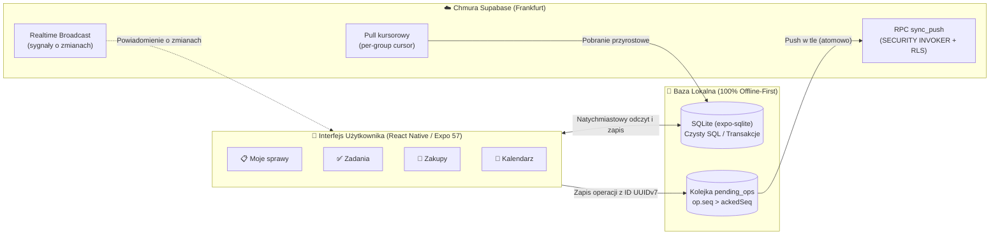

# Organizer 📋👨‍👩‍👧‍👦

[](https://www.apple.com/ios/)
[](https://expo.dev/)
[](https://reactnative.dev/)
[](https://www.typescriptlang.org/)
[](https://sqlite.org/)
[](https://supabase.com/)
[](docs/testing.md)
[](https://developer.apple.com/testflight/)

> **„Wszystkie sprawy Twojej rodziny i bliskich w jednym miejscu — prosto, przejrzyście i zawsze pod ręką.”**

Aplikacja mobilna na system iOS do organizacji codzienności w wielu grupach (rodzina, dom, znajomi, projekty), stworzona w architekturze **100% Offline-First** z widokiem zbiorczym **„Moje sprawy”** integrującym zadania z podzadaniami, wspólne listy zakupów oraz kalendarz.

---

## 🌟 Główne Zasady Produktowe

- **100% Offline-First (SQLite + pending_ops):** Ekrany czytają wyłącznie z lokalnej bazy SQLite (`expo-sqlite`, zwykły SQL w `src/data/db`). Każda modyfikacja (odznaczenie zadania, dodanie pozycji do listy zakupów) zapisuje się natychmiastowo w lokalnej transakcji bazodanowej wraz z wpisem do kolejki `pending_ops` (D2, R1). Aplikacja działa bez opóźnień nawet przy całkowitym braku sieci.
- **Grupa jako Kontener i Granica Bezpieczeństwa:** Pełna separacja spraw domowych, rodzinnych i towarzyskich. Trzy poziomy widoczności (`group` / `restricted` / `private`) gwarantują, że prywatne notatki nie trafiają do nieuprawnionych osób (D3).
- **Zero-Friction dla Bliskich (Profile bez Kont):** Domownicy, dzieci i seniorzy mogą uczestniczyć w życiu grupy jako profile lokalne (`member_id`) bez konieczności rejestracji, podawania adresu e-mail czy posiadania smartfona (D10, D34).
- **Deterministyczna Synchronizacja Chmurowa:** Oparta o backend Supabase (Frankfurt, D1). Zmiany wysyłane są atomowo przez procedurę RPC `sync_push` pod ścisłą kontrolą Row-Level Security (RLS jako jedyna kontrola dostępu). Pobieranie zmian (pull) opiera się na kursorze wersji per grupa (D32), a sygnały Realtime Broadcast informują o zdarzeniach bez przesyłania wrażliwych treści.
- **Odporność na Konflikty (UUIDv7 & UUIDv5):** Każdy obiekt posiada unikalny, sortowalny czasowo identyfikator UUIDv7 nadawany lokalnie na telefonie (`src/domain/ids.ts`, R3). Dla cyklicznych instancji zadań i deklaracji obecności stosowane są deterministyczne identyfikatory UUIDv5, co eliminuje duble przy równoległej pracy wielu urządzeń offline.
- **Pojedyncze Źródło Prawdy (Single Source of Truth):** Wszystkie limity (w tym maksymalna głębokość podzadań `MAX_TASK_DEPTH = 2`, D4), stałe czasowe i reguły biznesowe zdefiniowane są centralnie w module `src/config/`, podlegając automatycznym testom kontraktowym.

---

## 📱 Moduły i Ekrany (Status wdrożenia wg BRD 0.1)

Poniższa tabela przedstawia mapowanie modułów i wymagań biznesowych (02 BRD, Rozdział 6.2) na fizyczne ekrany i komponenty aplikacji wraz z aktualnym stanem wdrożenia:

| Moduł BRD | Kody wymagań | Główne ekrany i komponenty | Status wdrożenia | Kluczowe funkcje i gwarancje |
|---|---|---|:---:|---|
| **DOT: Moje sprawy (Dashboard)** | Z-111…Z-113, Z-039 | [`TodayScreen`](src/features/today/TodayScreen.tsx) | ✅ **100% Wdrożone** | Zbiorczy pulpit dnia/tygodnia/miesiąca, rolowanie zaległości, podsumowanie poranne, karty akcji, obsługa offline |
| **WIDŻET: Widżet iOS „Moje sprawy”** | Z-114, Z-115, D17 | [`OrganizerWidget`](targets/widget/OrganizerWidget.swift), [`widget-bridge`](modules/widget-bridge/) | ✅ **100% Wdrożone** | WidgetKit SwiftUI (Small, Medium, Lock Screen), synchronizacja w tle przez App Group i ciche pushe APNs |
| **ZAD: Zadania z podzadaniami** | Z-026…Z-040 | [`TaskScreen`](src/features/lists/TaskScreen.tsx), [`AddTaskScreen`](src/features/lists/AddTaskScreen.tsx) | ✅ **100% Wdrożone** | Hierarchia do 2 poziomów (`MAX_TASK_DEPTH`), cykliczność RRULE, dziedziczenie powtórzeń (ADR 0048), adresaci |
| **ZAK: Wspólne zakupy** | Z-056…Z-066 | [`ListScreen`](src/features/lists/ListScreen.tsx), [`ListsScreen`](src/features/lists/ListsScreen.tsx), [`TripEditor`](src/features/lists/TripEditor.tsx) | ✅ **100% Wdrożone** | 20 alejek, scalanie lematyzowane (`itemKey`), wycieczki (*Shopping Trip*), tryb sklepowy (Z-063: keep-awake, checkboxy 48 pt) |
| **KAL: Kalendarz i wydarzenia** | Z-081…Z-092 | [`CalendarScreen`](src/features/calendar/CalendarScreen.tsx), [`EventScreen`](src/features/events/EventScreen.tsx), [`EventEditScreen`](src/features/events/EventEditScreen.tsx) | ✅ **100% Wdrożone** | Siatka miesięcy (CLDR/ISO), wydarzenia wielodniowe, obsługa DST, RSVP, dialog osieroconych zadań, masowe przywracanie |
| **NLP: Szybkie dodawanie** | Z-034, Z-035 | [`QuickAddField`](src/ui/components.tsx), [`QuickAddExtras`](src/ui/QuickAddExtras.tsx), [`QuickGroupChip`](src/features/today/QuickGroupChip.tsx) | ✅ **100% Wdrożone** | Polski parser języka naturalnego w locie, rozpoznawanie dat, godzin, osób (`@`), grup (`#`) i chipy edycyjne |
| **GRP: Grupy, role i profile** | Z-126…Z-133 | [`GroupsScreen`](src/features/groups/GroupsScreen.tsx), [`GroupScreen`](src/features/groups/GroupScreen.tsx), [`MemberScreen`](src/features/groups/MemberScreen.tsx) | ✅ **100% Wdrożone** | Grupy osobiste i wspólne, role (właściciel, admin, członek, dziecko), profile bez kont, plany lekcji, kody zaproszeń |
| **POW: Powiadomienia i Handoffs** | Z-157, Z-158 | [`HandoffInbox`](src/features/handoffs/HandoffInbox.tsx), [`HandoffPicker`](src/features/handoffs/HandoffPicker.tsx), [`PushPrompt`](src/features/today/PushPrompt.tsx) | ✅ **100% Wdrożone** | Przekazywanie spraw, routing deep linków, ciche wybudzanie APNs, wyciszenia per kategoria i grupa |
| **SYN: Synchronizacja & Offline** | Z-151…Z-156 | [`expo-adapter`](src/data/db/expo-adapter.ts), [`sync-engine`](src/domain/sync-engine/), [`TabHeader`](src/app/TabHeader.tsx) | ✅ **100% Wdrożone** | 100% Offline-First SQLite, atomowy push RPC `sync_push`, kursorowy pull z budżetem, wskaźnik `pending_ops` |
| **KOSZ: Bezpieczne usuwanie** | Z-005, Z-006 | [`TrashScreen`](src/features/groups/TrashScreen.tsx), [`RecentScreen`](src/features/groups/RecentScreen.tsx), [`undo`](src/ui/undo.tsx) | ✅ **100% Wdrożone** | Osobny ekran kosza, retencja 30 dni, historia ostatnich zmian (90 dni), natychmiastowe cofanie akcji (*Undo*) |
| **DANE: Eksport i kopia JSON** | Z-013, ZP-11, NIGDY-04 | [`SettingsScreen`](src/features/settings/SettingsScreen.tsx) | ✅ **100% Wdrożone** | Eksport wszystkich danych użytkownika do otwartego pliku JSON (prawo do danych, brak paywalla) |
| **I18N: Wielojęzyczność (PL / EN)** | Złoty Standard Studio | [`strings.pl.ts`](src/i18n/strings.pl.ts), [`strings.en.ts`](src/i18n/strings.en.ts), [`check-i18n.mjs`](scripts/check-i18n.mjs) | ✅ **100% Wdrożone** | Kompletny słownik angielski (929 kluczy), dynamiczne przełączanie w locie (PL/EN) w Ustawieniach, bramka CI `check:i18n`, 100% symetrii |
| **MON: Monetyzacja i StoreKit** | Z-171…Z-174 | Warstwa subskrypcyjna, `useAppAccess()`, `PaywallModal` | ✅ **100% Wdrożone** | Model impulsowy „Cheaper than Espresso” ($0.99/msc, $4.99/rok, $14.99 Lifetime), 7-dniowy pełny trial, historia Read-Only po wygaśnięciu, SecureStore |

### Szczegółowy opis modułów:

1. **📋 Moje sprawy (`TodayScreen`):**
   - Inteligentne centrum dowodzenia zbierające zadania i wydarzenia ze wszystkich Twoich grup w jednym spójnym widoku.
   - Zadania z bieżącym terminem, pilne sprawy, dedykowane obowiązki oraz dzisiejsze wydarzenia z kalendarza.
   - Dynamiczne wskaźniki synchronizacji stanu w czasie rzeczywistym (`„czeka na wysłanie”`).
   - Nawigacja czasowa (Dzień, Tydzień, Miesiąc) z zachowaniem kontekstu daty.
2. **📱 Widżet iOS (`targets/widget/OrganizerWidget.swift`):**
   - Widżet WidgetKit na ekran początkowy iPhone'a (Small, Medium) oraz ekran blokady (Inline, Rectangular).
   - Współdzielenie danych z aplikacją przez App Group (`group.io.github.lkarwowski494.organizer`) i pamięć podręczną `today-widget.json`.
   - Błyskawiczne odświeżanie po cichych pushach APNs i powrocie do tła.
3. **✅ Zadania z Podzadaniami (`TaskScreen`, `AddTaskScreen`):**
   - Hierarchiczne drzewo zadań z obsługą zagłębienia do 2 poziomów (`MAX_TASK_DEPTH`) i wcięciem wizualnym.
   - Przypisywanie odpowiedzialnych osób, terminy (własne lub dziedziczone) oraz cykliczność RFC 5545 RRULE.
   - Ochronne dialogi potwierdzenia odhaczenia (D59) z wyborem: „Zostaw podzadania” lub „Oznacz wszystko”.
4. **🛒 Wspólne Listy Zakupów (`ListScreen`, `ListsScreen`, `TripEditor`):**
   - Kategoryzowane pozycje z inteligentnym podziałem na działy sklepowe, lematyzacją (`itemKey`) i pamięcią nawyków w grupie.
   - Tryb sklepowy (Z-063): automatyczne utrzymanie wybudzonego ekranu (`expo-keep-awake`) podczas zakupów oraz powiększone, ergonomiczne checkboxy ($48 \times 48\,\text{pt}$) zgodne z Apple HIG.
   - Błyskawiczne odznaczanie produktów w sklepie i natychmiastowy pasek cofania (*Undo*).
   - Wycieczka zakupowa (*Shopping Trip*) planowana w kalendarzu jako zadanie z terminem i zintegrowana z Moimi sprawami.
5. **📅 Wspólny Kalendarz & Wydarzenia (`CalendarScreen`, `EventScreen`, `EventEditScreen`):**
   - Siatka miesięcy od poniedziałku (zgodna z normą PN-EN ISO 8601 i CLDR dla PL) z polskimi dniami wolnymi.
   - Wydarzenia jedno- i wielodniowe, obsługa stref czasowych i przejść czasu letniego/zimowego (DST).
   - Potwierdzanie obecności RSVP (Idę / Nie idę / Może) z automatycznymi odpowiedziami dorosłych w imieniu dzieci.
   - Obliczanie czasu dojazdu i wyjścia oraz zarządzanie odwołanymi terminami serii z możliwością ich masowego przywracania.
   - Dyskretne lustro kalendarza iPhone'a z automatycznym ukrywaniem dubli wpisów aplikacji.
6. **⚡ Szybkie Dodawanie (`QuickAddField`, `QuickAddExtras`):**
   - Inteligentny parser języka naturalnego w języku polskim (`src/domain/quickadd.ts`).
   - Rozpoznaje w locie daty słowne, godziny, powtarzalność, osoby (`@Imię`) oraz grupy (`#Grupa`) z pojedynczej linii tekstu.
   - Interaktywne chipy edycyjne pod polem z natychmiastowym podglądem rozpoznanych pól przed zatwierdzeniem.
7. **👥 Zarządzanie Grupami & Członkowie (`GroupsScreen`, `GroupScreen`, `MemberScreen`, `TimetableScreen`):**
   - Konteksty grupowe (Osobiste, Dom, Rodzina, Znajomi, Szkoła) z 3 poziomami widoczności (`group` / `restricted` / `private`).
   - Role dostępu: właściciel (*owner*), administrator (*admin*), członek (*member*) oraz dziecko (*child*).
   - Profile lokalne bez kont dla domowników oraz bezpieczne zaproszenia kodem 6-cyfrowym i linkiem.
8. **⚙️ Ustawienia, Synchronizacja i Bezpieczny Kosz (`SettingsScreen`, `TrashScreen`, `RecentScreen`):**
   - Monitor stanu kolejki offline (`pending_ops`), diagnostyka bazy oraz natychmiastowy feedback stanu synchronizacji.
   - Bezpieczne usuwanie z mechanizmem kosza (`KOSZ`), retencją oraz paskiem natychmiastowego cofnięcia (*Undo*).
9. **📦 Eksport Danych i Kopia Zapasowa (`buildUserExport`, `SettingsScreen`):**
   - 100% otwarty format JSON obejmujący wszystkie grupy użytkownika, listy zadań i zakupów, zadania hierarchiczne i wydarzenia (wymóg Z-013, ZP-11, NIGDY-04).
   - Natywne udostępnianie systemowym arkuszem iOS (`Share.share`) bez blokad i paywalla.
10. **☕ Monetyzacja Impulsowa „Cheaper than Espresso” (`useAppAccess`, `PaywallModal`):**
    - Spójny model monetyzacji ekosystemu Apps4Brew Studio: $0.99 USD / miesiąc, $4.99 USD / rok, $14.99 USD Lifetime.
    - Zero podziału na wersje Free i Pro: 100% funkcji odblokowane w okresie próbnym (7 dni lub 15 utworzonych elementów).
    - Wieczna ochrona ocen 4.9★: po wygaśnięciu trialu cała dotychczasowa historia, listy, notatki i harmonogramy pozostają w 100% czytelne i możliwe do odhaczenia (tryb Read-Only dla archiwum). Blokowane jest wyłącznie tworzenie nowych wpisów z prezentacją Paywalla impulsowego.
    - 100% Offline-First: stan licencji zabezpieczony w `expo-secure-store` bez telemetrycznych trackerów.


---

## 🔄 Architektura Przepływu Danych & Synchronizacji



| Mechanizm | Implementacja w kodzie | Gwarancja biznesowa |
|---|---|---|
| **Odczyt/Zapis** | `expo-sqlite`, `src/data/db/` | Czas odpowiedzi interfejsu $< 16\,\text{ms}$, brak blokad sieciowych |
| **Generowanie ID** | `UUIDv7` (czasowe) / `UUIDv5` (deterministyczne) | Brak konfliktów kluczy przy pracy wielu telefonów offline |
| **Weryfikacja uprawnień** | PostgreSQL Row-Level Security (`RLS`) | Serwer odrzuca nieautoryzowane operacje (`forbidden:not_own`) |
| **Kolejka oczekujących** | `pending_ops` w `ClientState` | Wizualny wskaźnik `„czeka na wysłanie”` do czasu potwierdzenia `ackedSeq` |

---

## 🧪 9 Warstw Weryfikacji Jakości (Testing Rigor)

Projekt realizowany jest zgodnie z rygorystyczną definicją ukończenia (DoD):

1. **100% Pokrycia Linii i Gałęzi:** Bezwzględny wymóg pełnego pokrycia testami dla logiki domenowej (`src/domain`, `src/config`, `src/sync`, `src/data`).
2. **Testy Mutacyjne (Stryker):** Wymóg $\ge 90\%$ wykrytych mutacji kodu w warstwach kluczowych (`stryker.config.json`).
3. **Testy Własnościowe (Property-Based):** Weryfikacja niezmienników z użyciem biblioteki `fast-check`.
4. **Testy Niezależnych Korpusów:** Walidacja parsera QuickAdd, kontrastu kolorów WCAG, odmiany liczebników w języku polskim i przesunięć czasu (DST) z niezależnymi wzorcami generowanymi w Pythonie.
5. **Testy Bazodanowe i RLS:** Weryfikacja transakcji SQLite oraz polityk dostępu Supabase RLS za pomocą testów pgTAP.
6. **E2E & Wizualny Regres:** Automatyczne scenariusze Maestro na symulatorze iOS z rygorystycznym porównywaniem zrzutów ekranu (`pixelmatch`).
7. **Kontrakty Dostępności (WCAG AAA & Apple HIG):** Minimalna powierzchnia dotyku $44 \times 44\,\text{pt}$, unikalne etykiety VoiceOver i obsługa Dynamic Type.
8. **Strażnicy Wzorców Interakcji (`interaction-guards.test.ts`):** Zautomatyzowana kontrola czystych formularzy, przycisków rezygnacji i dialogów `Alert.alert`.
9. **Weryfikacja Licencji i Zależności iOS:** Zgodność licencji bibliotek na ekranie Ustawień z faktyczną paczką iOS (`check:licenses`).

---

## 🛠️ Uruchomienie i Weryfikacja

Wymagane środowisko: Node.js 20+ oraz npm.

```bash
# Instalacja zależności
npm install

# Pełna weryfikacja projektu (typy, lint, testy z pokryciem, funkcje, korpusy, licencje)
npm run check

# Uruchomienie testów jednostkowych i integracyjnych Jest
npm test

# Szybkie testy jednostkowe tylko dla zmienionych plików
npm run test:fast

# Testy czystej logiki domenowej
npm run test:domain

# Uruchomienie testów mutacyjnych Stryker
npm run test:mutation

# Uruchomienie aplikacji w środowisku deweloperskim Expo
npm run start

# Uruchomienie aplikacji na symulatorze iOS
npm run ios
```

---

## 📂 Architektura Kodu

```text
organizer/
├── src/
│   ├── domain/                 # Czysty TypeScript: reguły biznesowe, QuickAdd, RRULE, UUIDv7, formatowanie
│   │   ├── sync-engine/        # Matematyczny model synchronizacji i rozwiązywania konfliktów
│   │   └── views/              # Projekcje i transformacje widoków
│   ├── features/               # Moduły funkcjonalne UI
│   │   ├── today/              # Widok zbiorczy „Moje sprawy” (agregacja międzygrupowa)
│   │   ├── lists/              # Zadania z podzadaniami oraz wspólne listy zakupów
│   │   ├── calendar/           # Kalendarz, siatka miesięcy i widok agendy
│   │   ├── events/             # Wydarzenia, reguły RRULE i obecności RSVP
│   │   ├── groups/             # Zarządzanie grupami, zaproszenia i uprawnienia
│   │   ├── auth/               # Uwierzytelnianie Apple & Supabase
│   │   ├── profile/            # Profile użytkowników i domowników bez kont
│   │   ├── handoffs/           # Przekazywanie spraw i opieki
│   │   └── settings/           # Ustawienia, stan kolejki pending_ops, diagnostyka
│   ├── sync/                   # Klient synchronizacji chmurowej: push/pull, retry, detekcja offline
│   ├── data/                   # Baza lokalna SQLite (expo-sqlite, czysty SQL, transakcje)
│   ├── config/                 # Pojedyncze źródło prawdy: limity, stałe, palety kolorów
│   └── i18n/                   # Polskie teksty i gramatyczna odmiana liczebników (plural.ts)
├── supabase/                   # Schemat bazy, migracje SQL, polityki RLS i Edge Functions (Deno)
├── .maestro/                   # Scenariusze testów E2E i wzorce screenshotów (pixelmatch)
├── scripts/                    # Narzędzia CI: generatory korpusów, audyty i weryfikacja licencji
└── docs/                       # Dokumentacja projektowa, wzorce interakcji i rejestr decyzji (docs/adr)
```

---

## 📖 Dokumentacja i Rejestr Decyzji

- **Zasady pracy i architektura:** [`CLAUDE.md`](CLAUDE.md)
- **Rejestr decyzji architektonicznych:** [`docs/adr/`](docs/adr)
- **Przepływy i nawigacja:** [`docs/01-przeplywy-i-nawigacja.md`](docs/01-przeplywy-i-nawigacja.md)
- **Definicja ukończenia (DoD):** [`docs/20-definicja-ukonczenia.md`](docs/20-definicja-ukonczenia.md)
- **Wzorce interakcji:** [`docs/32-wzorce-interakcji.md`](docs/32-wzorce-interakcji.md)
- **Strategia testów:** [`docs/testing.md`](docs/testing.md)
- **Limity systemowe:** [`docs/limits.md`](docs/limits.md)

---

## 📄 Status & Dystrybucja

- **Dystrybucja:** Wersja testowa w Apple TestFlight (od 8.10.2026).
- **Zasady interakcji:** Pełna zgodność z iOS Human Interface Guidelines, wsparcie VoiceOver, Dynamic Type i wysoki kontrast WCAG AAA.
- **Prywatność:** Architektura 100% Offline-First — dane przechowywane lokalnie w SQLite, synchronizacja chmurowa pod kontrolą Row-Level Security (RLS).
